# NovelScape

NovelScape bridges the gap between written narrative and multimodal AI generation.
Instead of jumping between a dozen isolated tools, an author pastes a chapter, lets a
Large Language Model extract optimized generation prompts, triggers parallel
image/music/SFX generation, and assembles everything on an interactive timeline into a
single exported mix — all from one interface.

A key design goal is **provider-agnosticism**: the backend routes each request to
either a **cloud API** (Google Gemini, ElevenLabs) or a **local open-source model**
(Stable Diffusion XL, Meta AudioCraft), swappable via configuration with no changes to
the API or frontend.

This repository accompanies a **Bachelor of Science thesis** (University of Vienna,
*Computer Science – Data Science*, 2026) by **Jakub Kotkowski**.

---

## Table of Contents

- [Screenshots](#screenshots)
- [Features](#features)
- [Architecture](#architecture)
- [Tech stack](#tech-stack)
- [Repository layout](#repository-layout)
- [Prerequisites](#prerequisites)
- [Setup](#setup)
  - [1. Backend](#1-backend)
  - [2. Frontend](#2-frontend)
- [Running the app](#running-the-app)
- [Using NovelScape](#using-novelscape)
- [Configuration reference](#configuration-reference)
- [API reference](#api-reference)
- [Evaluation highlights](#evaluation-highlights)
- [License & academic context](#license--academic-context)

---

## Screenshots

**Dashboard**

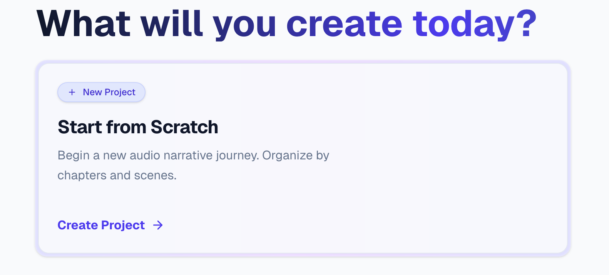

**Chapter overview**

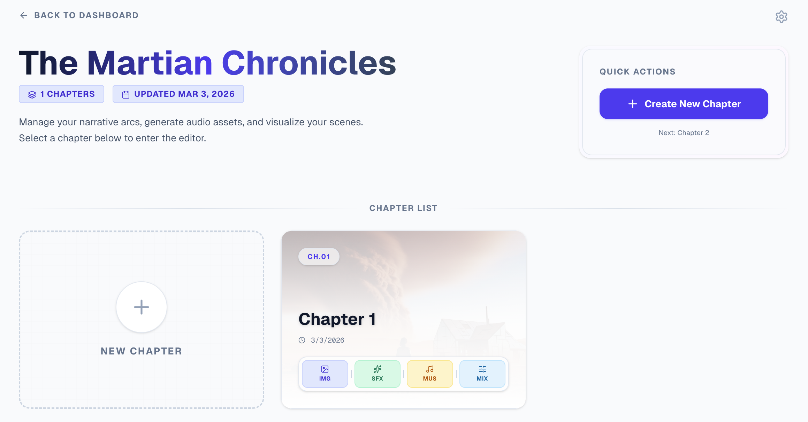

**Editor**

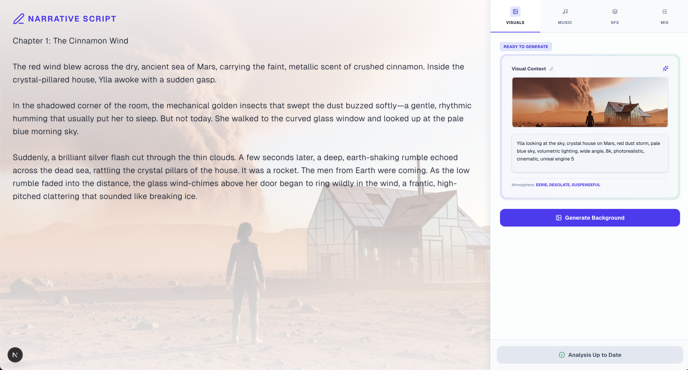

**The modular generative tab system**

| Visuals | Music |
| --- | --- |
| 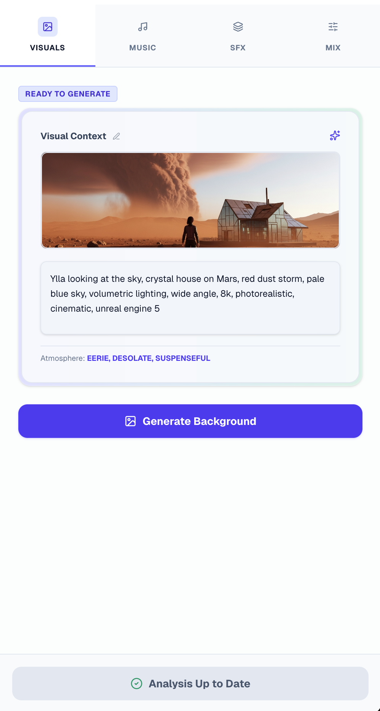 | 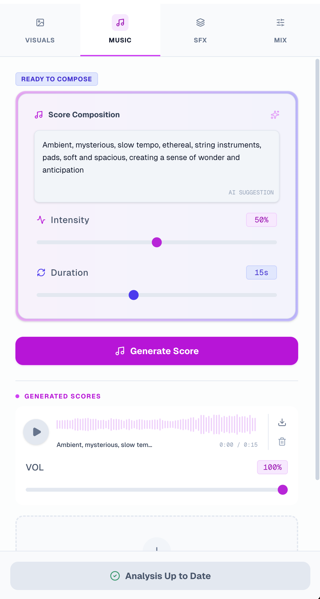 |

| SFX | Mix |
| --- | --- |
| 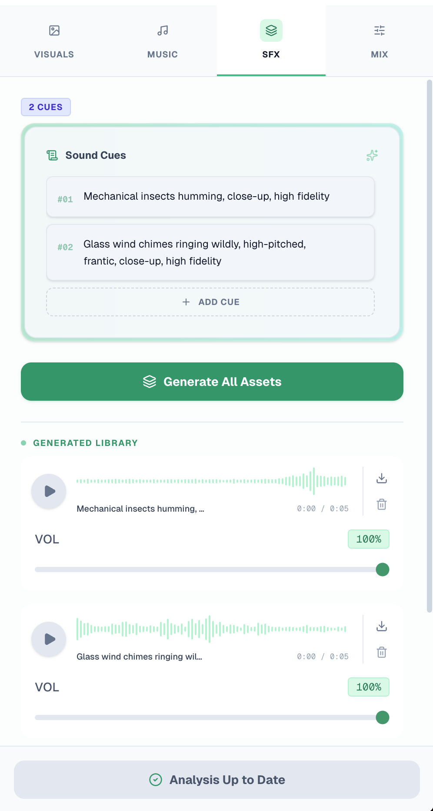 | 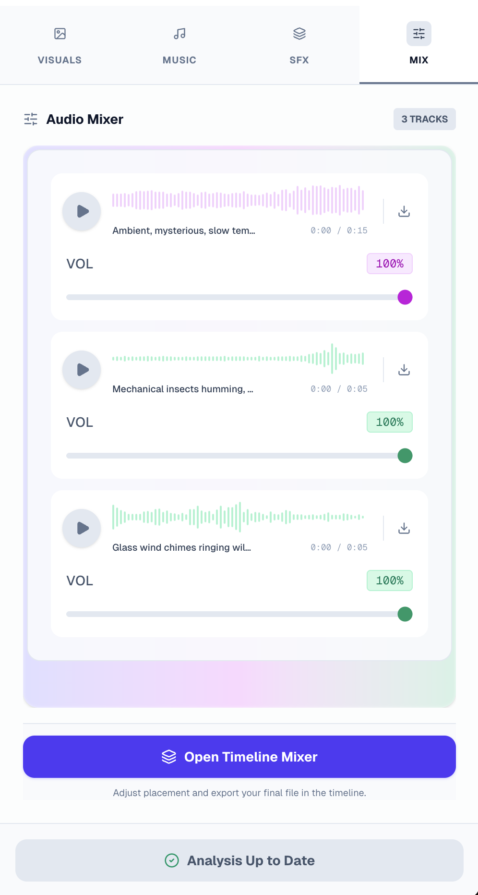 |

**Reactive analysis engine — the state indicator at the bottom of the editor**

| No text | Ready | Synchronized | Dirty |
| --- | --- | --- | --- |
| 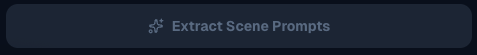 | 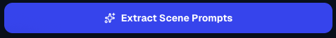 | 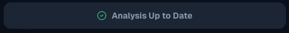 |  |

---

## Features

- **Semantic scene analysis** — an LLM acts as a *semantic router*, reading a chapter
  and returning optimized technical prompts: a `visual_prompt` (keyword-style, for
  diffusion models), a `music_prompt`, a list of `sfx_prompts`, and a short
  `atmosphere` summary. Prompts are editable if the user isn't satisfied.
- **Provider-agnostic generation** — swap engines via `config.yaml`:
  - **Images** — Gemini Imagen (cloud) or Stable Diffusion XL (local GPU).
  - **Music** — MusicGen / AudioCraft (local) or ElevenLabs (cloud).
  - **Sound effects** — AudioGen / AudioCraft (local) or ElevenLabs (cloud).
- **Reactive analysis engine** — a state indicator signals whether the AI prompts are
  *Synchronized* with the prose or *Dirty* (text changed → re-analysis needed), gating
  redundant API calls.
- **Dual-pane editor** — a narrative canvas with **dynamic background rendering** (the
  generated scene image becomes a semi-transparent backdrop) beside a color-coded
  asset panel.
- **Interactive timeline mixer** — place, trim, offset, and volume-balance audio stems
  on a visual timeline; the backend flattens them into one WAV with FFmpeg
  (`atrim` → `volume` → `adelay` → `amix normalize=False`), preserving your manual
  volume ratios.
- **Chapter organization & asset status** — per-chapter cards show `IMG / SFX / MUS /
  MIX` badges reflecting generation progress.
- **Interactive setup wizard** — a first-run CLI wizard selects providers and collects
  the required API keys.
- **Hardware-aware local inference** — local engines prefer GPU acceleration (NVIDIA
  CUDA / Apple MPS) where available, falling back to CPU.

---

## Architecture

NovelScape uses a **decoupled three-tier architecture** — a *Presentation Layer*
(Next.js), an *Orchestration Layer* (FastAPI routing + a service controller), and an
*Execution Layer* (the generative engines). The UI talks to the backend over
REST/JSON; the backend triggers generation, saves physical files to storage, and
returns URL references.

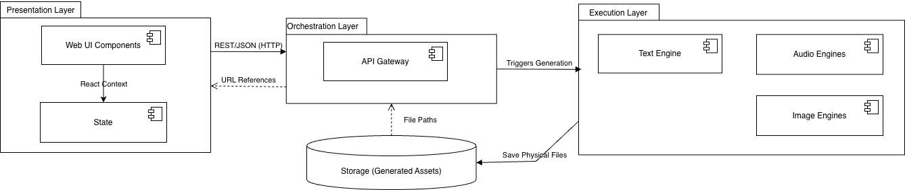

**Orchestration & Execution (backend).** API routers validate every payload against
Pydantic schemas, a central *Service Coordinator* reads `config.yaml` to pick the
provider, and each engine implements a common interface so cloud and local models are
interchangeable. The `Synthesis Mixer` assembles audio stems into a final file.

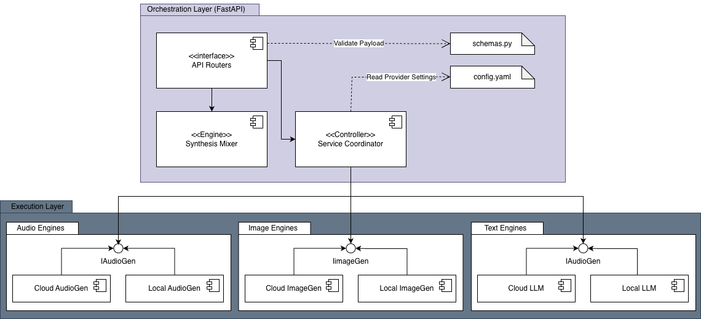

**Presentation (frontend).** UI components consume a split global state —
`NarrativeContext` (high-frequency text edits) and `AssetContext` (heavy media
state) — through business-logic hooks (`useNarrative`, `useMixer`,
`useMusicGeneration`, …) that call a dedicated API client. State auto-saves to
localStorage.

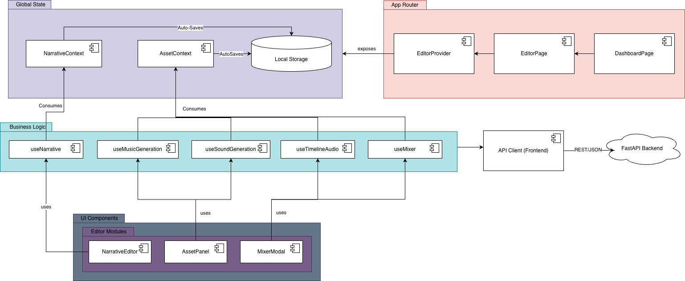

Each engine is a self-registering class (`@EngineRegistry.register("name")`),
auto-discovered on boot by scanning `backend/app/engines/`. The upper tiers stay blind
to whether a provider is cloud or local. Generated files are written to
`backend/generated_*` folders and served back as static assets; the frontend never
calls AI providers directly.

---

## Tech stack

**Backend (Orchestration + Execution):** Python · FastAPI · Uvicorn · Pydantic
(data contracts) · Loguru (request-ID logging) · FFmpeg via `ffmpeg-python` (mixing) ·
PyTorch · Meta AudioCraft (MusicGen / AudioGen, vendored in `backend/audiocraft/`) ·
Hugging Face `diffusers` (SDXL) · Google GenAI SDK · ElevenLabs SDK. Async request
handling via `asyncio`.

**Frontend (Presentation):** Next.js 16 (App Router) · React 19 · TypeScript ·
Tailwind CSS 4 · HeroUI · Framer Motion · Lucide React (icons) · WaveSurfer.js /
Tone.js (audio preview). State via the React Context API + custom hooks (no heavy
external state library).

---

## Repository layout

```
NovelScape/                     (local dir: NovelAudio/)
├── backend/                    # Orchestration & Execution layers
│   ├── main.py                 # FastAPI entrypoint (Uvicorn, CORS, static mounts)
│   ├── config.yaml             # Active provider selection (written by the setup wizard)
│   ├── requirements.txt        # ML / AudioCraft dependencies (see setup notes)
│   ├── app/
│   │   ├── config.py           # Env + YAML config, generated-asset directories
│   │   ├── boot_setup.py       # First-run interactive setup wizard
│   │   ├── routers/            # Routing tier: analyze · audio · images · mixer
│   │   ├── services.py         # Service controller ("traffic director")
│   │   ├── engines/            # Provider-agnostic engine tier (auto-discovered)
│   │   │   ├── base.py         # BaseEngine + EngineRegistry
│   │   │   ├── text/           # gemini_text
│   │   │   ├── image/          # gemini_imagen · local_sdxl
│   │   │   ├── audio/          # local_musicgen · local_audiogen · elevenlabs_* · huggingface_sfx
│   │   │   └── mixer_engine.py # FFmpeg-based synthesis mixer
│   │   ├── schemas.py          # Pydantic request/response contracts
│   │   └── logger.py / middleware.py / utils.py
│   ├── audiocraft/             # Vendored Meta AudioCraft (used by local audio engines)
│   └── generated_audio|images|music|mixes|videos/   # Output (gitignored)
└── frontend/                   # Presentation layer
    ├── app/                    # App Router: (dashboard) and (editor) route groups
    ├── components/             # dashboard · editor (asset-panel, timeline) · layout · ui
    ├── context/EditorContext.tsx   # NarrativeContext + AssetContext
    ├── hooks/                  # useNarrative · useMixer · useMusicGeneration · ...
    ├── lib/                    # api.ts (backend client) · storage.ts (localStorage) · config.ts
    └── types/api/             # Payload & response TypeScript contracts
```

---

## Prerequisites

| Tool | Version | Notes |
| --- | --- | --- |
| **Python** | 3.9 – 3.11 | PyTorch 2.1.0 / AudioCraft pin the usable range; 3.10 or 3.11 recommended. |
| **Node.js** | 18+ (20/22 recommended) | For the Next.js frontend. |
| **FFmpeg** | any recent | Required by the mixer. Must be on your `PATH` (`ffmpeg -version`). macOS: `brew install ffmpeg`. |
| **GPU (optional)** | CUDA / Apple MPS | Only for *local* models (SDXL / MusicGen / AudioGen). Cloud providers need no GPU. |

**API keys** (only for the providers you enable):

- `GEMINI_API_KEY` — Gemini text/image (Google AI Studio).
- `ELEVENLABS_API_KEY` — ElevenLabs music/SFX.

The default configuration uses **Gemini** for text/image and **local
MusicGen/AudioGen** for audio, so at minimum you need a `GEMINI_API_KEY`.

---

## Setup

### 1. Backend

```bash
cd backend

# Create and activate a virtual environment
python3 -m venv venv
source venv/bin/activate          # Windows: venv\Scripts\activate

# Install dependencies (ML / AudioCraft stack + web layer + provider SDKs)
pip install -r requirements.txt
```

**First run — the setup wizard.** The backend detects a missing `config.yaml` and
launches an interactive wizard (`boot_setup.py`) that lets you choose each engine and
enter the needed API keys. It writes your choices to `config.yaml` and your keys to
`backend/.env`, and creates the generated-asset directories:

```bash
python main.py
```

You'll be prompted like this:

```
==================================================
🚀 Welcome to the NovelScape Backend Setup!
==================================================

[Text Analysis Engine]
1: Gemini 2.0 Flash (Cloud)
...
[Image Generation Engine]
1: Gemini Imagen 3 (Cloud - Fast)
2: Stable Diffusion XL (Local - GPU)
...
🔑 API Keys Required for your selections:
Enter GEMINI_API_KEY: ...
```

> The wizard runs only when `config.yaml` is absent. To reconfigure later, delete
> `backend/config.yaml` and run `python main.py` again, or edit the file by hand (see
> [Configuration reference](#configuration-reference)).

To skip the wizard, create the files manually:

`backend/.env`
```dotenv
GEMINI_API_KEY=your_key_here
ELEVENLABS_API_KEY=your_key_here   # only if you use ElevenLabs
BACKEND_HOST=127.0.0.1
BACKEND_PORT=8000
```

`backend/config.yaml`
```yaml
text_generation:
  default_provider: gemini_text
  model: gemini-2.0-flash-lite
image_generation:
  default_image_provider: gemini_image
audio_generation:
  default_sfx_provider: local_sfx
  default_music_provider: local_music
  music_model: facebook/musicgen-small
```

### 2. Frontend

```bash
cd frontend
npm install
```

Create `frontend/.env.local` pointing at the backend:

```dotenv
NEXT_PUBLIC_BASE_URL=http://localhost:8000
```

---

## Running the app

Run the two services in separate terminals.

**Terminal 1 — backend** (from `backend/`, venv active):

```bash
python main.py
```

The API starts on **http://127.0.0.1:8000** (auto-reload enabled). Verify:

```bash
curl http://127.0.0.1:8000/        # → {"status":"NovelScape Backend is running"}
```

> The first time a **local** model is used it downloads weights from Hugging Face,
> which can take a while. Cloud providers respond immediately.

**Terminal 2 — frontend** (from `frontend/`):

```bash
npm run dev
```

Open **http://127.0.0.1:3000**.

> CORS is configured for `http://localhost:3000` and `http://127.0.0.1:3000`. To serve
> the frontend from another origin, add it to `allow_origins` in `backend/main.py`.

---

## Using NovelScape

1. **Create a project** on the dashboard and give it a name. Projects and chapters are
   stored client-side in the browser (localStorage), so no database is required.

   

2. **Open a chapter** from the chapter overview. Each chapter card shows `IMG / SFX /
   MUS / MIX` status badges so you can track progress at a glance.

   

3. **Write/paste** your narrative into the left-hand *narrative canvas*.

4. **Analyze the scene.** The reactive analysis engine sends your text to the LLM
   "cinematographer/sound director", which returns a visual prompt, a music prompt,
   SFX prompts, and an *atmosphere*. The state indicator shows **Ready → Synchronized**
   and flips to **Dirty** whenever you edit the prose (so you re-analyze only when
   needed (see the state indicators in [Screenshots](#screenshots)).

5. **Generate assets** from the color-coded tabs in the right-hand asset panel:
   - **Visuals** — generate a scene image (injected as the editor's dynamic background).
   - **Music** — generate an atmospheric background track (set a duration).
   - **SFX** — generate discrete sound cues; audition them on per-card players.
   - **Mix** — open the timeline mixer. You can also **upload** your own audio.

   

6. **Assemble on the timeline.** Set each stem's start time, duration, volume, and
   mute; the editor previews alignment.

   

7. **Export the mix.** The backend applies the FFmpeg filter chain and returns a single
   mixed WAV for playback and download.

---

## Configuration reference

### `config.yaml` — provider selection

| Section | Key | Options |
| --- | --- | --- |
| `text_generation` | `default_provider` | `gemini_text` |
| `text_generation` | `model` | e.g. `gemini-2.0-flash-lite` |
| `image_generation` | `default_image_provider` | `gemini_image`, `local_sdxl` |
| `audio_generation` | `default_sfx_provider` | `local_sfx` (AudioGen), `elevenlabs_sfx` |
| `audio_generation` | `default_music_provider` | `local_music` (MusicGen), `elevenlabs_music` |
| `audio_generation` | `music_model` | e.g. `facebook/musicgen-small` |

### Environment variables

| Variable | Where | Purpose |
| --- | --- | --- |
| `GEMINI_API_KEY` | `backend/.env` | Gemini text + image |
| `ELEVENLABS_API_KEY` | `backend/.env` | ElevenLabs music + SFX |
| `BACKEND_HOST` / `BACKEND_PORT` | `backend/.env` | Backend bind address (defaults `127.0.0.1:8000`) |
| `NEXT_PUBLIC_BASE_URL` | `frontend/.env.local` | Backend URL the frontend calls |

### Adding a new provider

Engines auto-register via the `@EngineRegistry.register("name")` decorator and are
discovered on boot. To add one: drop a module in the relevant `engines/` subfolder,
register it, add it to the `SETUP_SCHEMA` options in `backend/app/boot_setup.py`, and
select it in `config.yaml`. The orchestration and presentation layers require no
changes.

---

## API reference

Base URL: `http://127.0.0.1:8000` — interactive docs at **`/docs`** (Swagger UI).

| Method | Endpoint | Body | Returns |
| --- | --- | --- | --- |
| `GET` | `/` | — | Health check |
| `POST` | `/analyze` | `{ "text": "..." }` | `{ visual_prompt, music_prompt, sfx_prompts[], atmosphere }` |
| `POST` | `/generate-image` | `{ "prompt": "..." }` | `{ url }` |
| `POST` | `/generate-music` | `{ "prompt": "...", "duration": 15 }` | `{ url }` |
| `POST` | `/generate-audio` | `{ "prompts": ["..."], "duration": 10.0 }` | generated SFX |
| `POST` | `/upload` | multipart `file` + `category` | `{ filename, url, category }` |
| `POST` | `/mix` | `{ "tracks": [ { filename, category, start_time, duration, volume, muted } ] }` | `{ url }` |

Static files are served from `/audio`, `/images`, `/music`, and `/mixes`.

---

## Evaluation highlights

From the thesis evaluation (500-word narrative, averaged over 5 cycles on an Apple M3
Max, 32 GB):

| Task | Provider | Avg. latency |
| --- | --- | --- |
| Semantic analysis | Google Gemini | 1.4 s |
| Image generation (cloud) | Gemini Imagen | 3.8 s |
| Image generation (local) | SDXL Turbo | 11.2 s |
| Audio generation (cloud) | ElevenLabs | 2.9 s |
| Audio generation (local) | AudioCraft | 38.5 s |

A small blind user study (3 participants across technical backgrounds) reached a 100%
task-success rate with no onboarding. The main takeaway: local **image** generation is
highly viable, while local **audio** still lags cloud APIs on latency and fidelity —
practical validation for the provider-agnostic design.

---

## License & academic context

Academic project — Bachelor of Science thesis, *"Orchestrating Generative AI Engines:
Building a Provider-Agnostic System for Narrative Immersive Experiences"*, University
of Vienna (Computer Science – Data Science), 2026, by Jakub Kotkowski.

Upstream source: https://github.com/jakubkotkowski/novelscape

The vendored `backend/audiocraft/` directory is Meta's AudioCraft and carries its own
license. Cloud providers (Google Gemini, ElevenLabs) are subject to their respective
terms of service.
